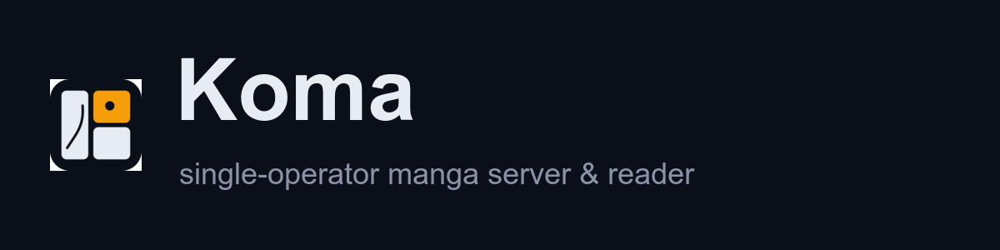
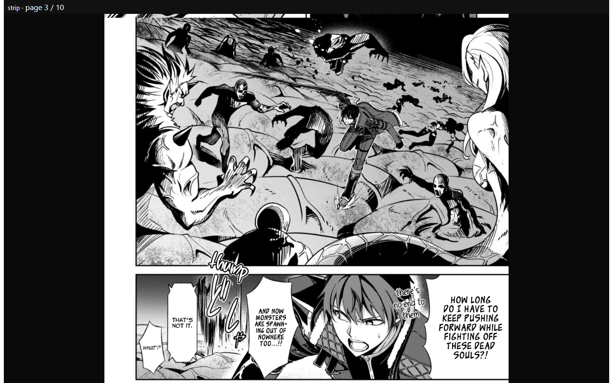
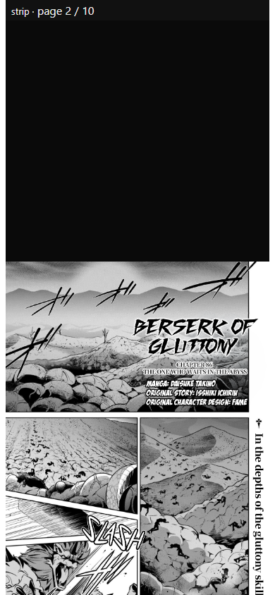
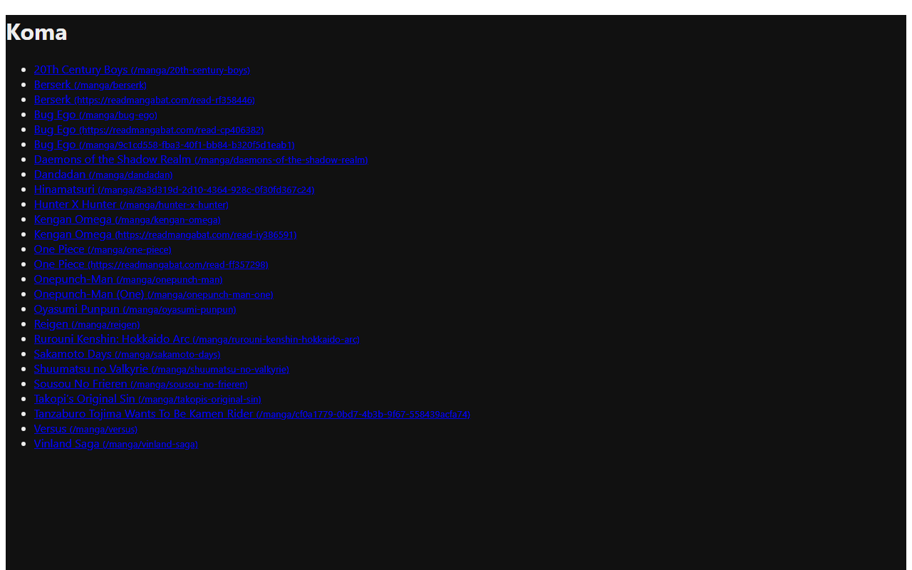
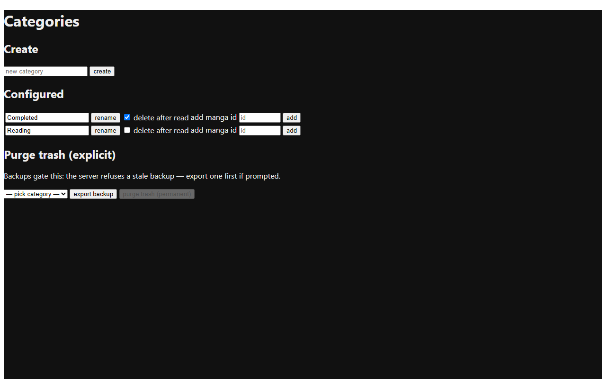
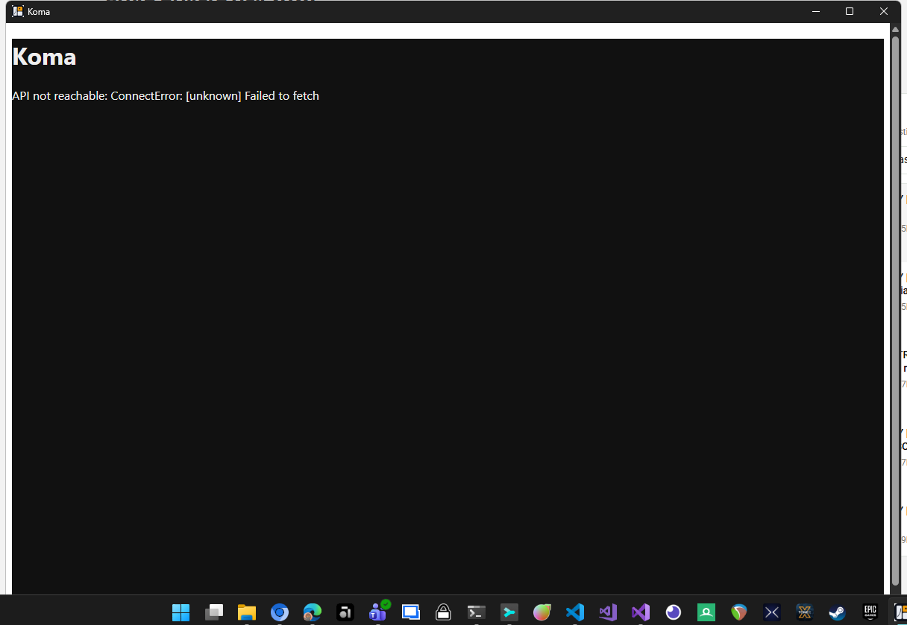

<p align="center">
  
</p>

<p align="center">
  <a href="https://github.com/liordino/koma/actions/workflows/ci.yml"></a>
  
  
  
</p>

---

*Koma* (**コマ**) — the manga panel — is a **single-operator, opinionated reference
implementation** of a self-hosted manga server and reader: a ground-up rewrite of
Suwayomi-Server's role, **not** a community Suwayomi alternative. Built and maintained for
exactly one user; requests for new sources or reader modes are tracked, never committed.

## The reader

Vertical strip reading (webtoon-style, the only mode in v1) with a windowed loader:
pages preload around your position, far pages unmount, and **progress is page-anchored** —
reload or return on another device and you land exactly where you stopped.

<p align="center">
  <a href=".github/assets/screenshot-reader.png">
    
  </a>
  <br>
  <a href=".github/assets/screenshot-reader-mobile.png">
    
  </a>
  <em><sub>desktop and phone — rotate freely; spreads fit width in landscape.</sub></em>
</p>

## Library and categories

<p align="center">
  <a href=".github/assets/screenshot-library.png">
    
  </a>
  &nbsp;&nbsp;
  <a href=".github/assets/screenshot-categories.png">
    
  </a>
</p>

Destructive flags (`delete after read`) sit behind a typed consent dialog, and purging
trash is a two-gate action: a **fresh metadata backup first**, then an explicit confirm.
These stop conditions are enforced in code, not just documented.

## Desktop companion

A thin Tauri 2 shell — no sidecar, no embedded server: it opens the web origin and contains
zero server logic (web and native stay on separate origins, by design). On probation —
cut at any daily-use failure until ratified.

<p align="center">
  <a href=".github/assets/screenshot-desktop.png">
    
  </a>
</p>

## What it is

- **Backend:** Rust — Axum + Tonic (gRPC-Web, unary — permanent) + SQLx/SQLite (FTS5 trigram search).
- **Frontend:** SvelteKit SPA; Tauri shell as the native client.
- **Core loop:** search sources with badges → add to a category → download the full chapter
  (At-Home compliant) → read in the windowed reader → progress resumes in ≤ 2 interactions.
  Measured end-to-end on a Raspberry Pi Zero 2 W: **25.9 s** against a 90 s budget.

## Source policy — the two-tier reality

This project does not pretend all its sources are official public APIs:

- **Tier A — documented, third-party-invited APIs: MangaDex only.** Fully supported, with
  At-Home image-delivery compliance (report-key flow, per-plane rate budgets) from day one.
- **Tier B — undocumented endpoints, personal-risk automation** (e.g. ComicWalker, Webtoon):
  would ship as default-off cargo features, trivially removable. None exist in the public
  repo today; they are personal-use options, not endorsements.
- **MangaDex is the only source in the public shipping list.** Adapters relying on an
  unofficial/internal API are maintained privately, if at all. MANGA Plus is not supported
  publicly, period.
- A new source enters the roadmap only after a verification sheet: endpoint documentation,
  auth, rate limits, ToS review, and image-delivery origin.

## Status

Implemented and gated by tests (Rust suite + Playwright, proven on the pinned
Raspberry Pi Zero 2 W): SSRF-guarded outbound fetch with per-source rate budgets; the
MangaDex adapter with At-Home-compliant downloads; a DB-backed download queue; idempotent
library auto-update; bearer-token auth on every route; path-safe page serving; the windowed
reader with resumable progress; category config with consent-gated destructive flags and
backup-gated purge; staged `.tachibk` (Mihon/Tachiyomi) import. SPA pages: library, reader,
categories. Search and adding titles ride the gRPC API today (the core loop is proven
end-to-end on-device); a dedicated search page is future UI work.

## Running it

On the deployment host (Docker):

```bash
scripts/build-release.sh    # stage the image context (binary + SPA)
docker compose up -d        # koma on 127.0.0.1:8080, web UI on 127.0.0.1:8081
```

`KOMA_TOKEN` (required) is set via the environment or `.env`. The compose ships the
loopback-only binding as the default; wider exposure is out of scope for v1 — the
sanctioned path is a private overlay (Tailscale/WireGuard) plus a reverse proxy.

## Development

Cargo workspace (`server`, `desktop`) + SvelteKit app (`web`). Gates:
`cargo nextest run`, `cargo clippy --all-targets -- -D warnings`, `npx tsc --noEmit` in
`web/`, Playwright specs in `web/tests` (need a live seeded server), and
`scripts/dojo-check.sh` for the signed proof artifact. Architecture decisions and their
rationale live in the tracked decision log (`.dojo/CONTEXT.md`).

## Authentication

Koma ships **in-app bearer-token authentication**: every API route — including page
images, served fetch-to-blob — requires a token. The token model is per-user data, so
multi-user support can arrive later without a redesign. v1 is single-user.

## DMCA response posture

Koma itself hosts no copyrighted content: it indexes configured third-party services and
caches pages privately for one operator's reading. If a rights holder nonetheless has a
complaint about this repository (documentation, code, or bundled data), send the standard
notice elements (identification, description of infringed work, claimed infringement,
contact) and we will remove or disable access to the identified material promptly.

## License

MIT — see [LICENSE](LICENSE). The name *koma* (コマ) is the manga panel — the frame the
story is told in.
